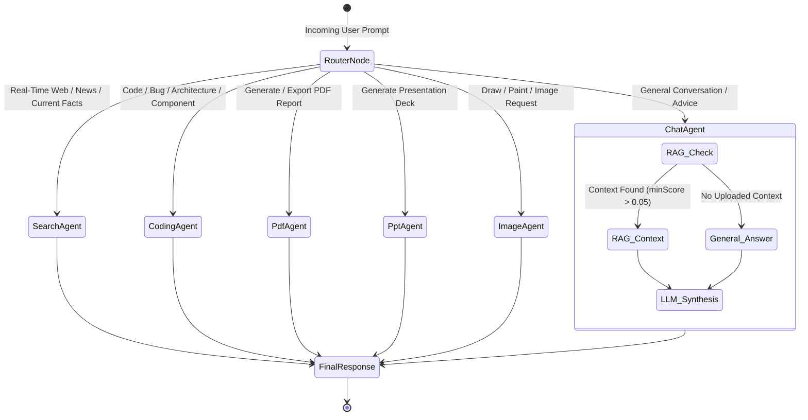

# Cortex AI — Master Project Report & Viva Voce Guide

**Project Name:** Cortex AI — Production-Grade Multi-Agent AI Platform  
**Developer:** Rohit Kumar  
**Institution:** Government Engineering College, Ajmer  
**Degree:** Bachelor of Technology (B.Tech) in Computer Science & Engineering (2023 – 2027)  
**Repository:** [https://github.com/rohitkumar2438/Cortex.ai](https://github.com/rohitkumar2438/Cortex.ai)  
**Date:** October 2026  

---

## 1. Executive Abstract & Objectives

Modern artificial intelligence applications typically rely on a single, monolithic large language model (LLM) trying to solve every domain problem. This approach creates high failure rates, token bloat, and hallucinations when handling specialized tasks such as real-time web discovery, code artifact sandboxing, vector knowledge retrieval (RAG), and structured document generation.

**Cortex AI** solves this by implementing an asynchronous, event-driven **Multi-Agent Orchestration Platform** powered by **LangGraph StateGraph**, a centralized **API Gateway**, independent microservices, and a reactive **Vite + React 19 Single Page Application**. 

### Core Platform Capabilities
1. **Intent-Driven Multi-Agent Routing:** Classifies user intent in under 150ms and routes queries across 6 domain-specialized agents:
   - **Chat Agent:** Multi-turn conversational reasoning and deep logic (Groq / Qwen / LLaMA).
   - **Search Agent:** Live web search grounding with verified sources and images (Tavily Search API).
   - **Coding Agent:** Full-stack development with sandboxed HTML/CSS/JS live preview (DeepSeek / Groq fallback).
   - **PDF Document Agent:** Formal executive report compilation (`PDFKit`).
   - **PowerPoint (PPT) Agent:** Presentation slide deck generator (`PptxGenJS`).
   - **Visual Image Agent:** Generative artwork synthesis with AI prompt engineering (Pollinations).
2. **Private RAG Knowledge Base:** Zero-cloud in-memory hybrid vector store (combining 384-dimensional dense semantic projections with exact keyword/BM25 token boosting) supporting multi-document upload, automatic chunking, and source citation badges.
3. **Observability & Health Aggregation:** Central `/health/all` latency monitoring, request tracing (`x-request-id`), and interactive OpenAPI 3.0 / Swagger UI (`/docs`).
4. **Microservices Architecture:** 8 Dockerized containers with zero cross-service coupling behind an API Gateway with Redis caching and Mongo persistence.
5. **Credit & Billing Engine:** Atomic credit deduction and top-up checkout modal powered by Razorpay.

---

## 2. System Architecture & Topology

```
                                  [ Client Browser ]
                                (React 19 / Vite SPA)
                                          │
                                   Port 5173 / 80
                                          ▼
                         ┌─────────────────────────────────┐
                         │       API Gateway (Port 8000)   │
                         │  • Rate Limiter (express-limit) │
                         │  • Session-to-User Decorator    │
                         │  • Swagger UI (/docs)           │
                         │  • Health Aggregator (/health)  │
                         └───────┬──────┬──────┬──────┬────┘
                                 │      │      │      │
           ┌─────────────────────┘      │      │      └──────────────────────┐
           ▼                            ▼      ▼                             ▼
┌────────────────────┐  ┌───────────────────┐  ┌────────────────────┐  ┌────────────────────┐
│ Auth Microservice  │  │ Chat Microservice │  │ Agent Microservice │  │Billing Microservice│
│    (Port 8001)     │  │    (Port 8002)    │  │    (Port 8003)     │  │    (Port 8004)     │
│ • Firebase Auth    │  │ • Threads & Conv  │  │ • LangGraph Router │  │ • Razorpay Orders  │
│ • Session Cookies  │  │ • Mongo Messages  │  │ • 6 Specialized    │  │ • Atomic Deduction │
│ • User Profiles    │  │ • History Search  │  │   Agents & RAG     │  │ • Pack Top-Ups     │
└─────────┬──────────┘  └────────┬──────────┘  └────────┬───────────┘  └─────────┬──────────┘
          │                      │                       │                        │
          └───────────┬──────────┴───────────────┬───────┴────────────────────────┘
                      ▼                          ▼
            ┌──────────────────┐       ┌──────────────────┐
            │ MongoDB Database │       │  Redis Cache     │
            │   (Port 27017)   │       │   (Port 6379)    │
            │ • Users, Credits │       │ • Active Session │
            │ • Conversations  │       │ • Rate Limit DB  │
            │ • Messages       │       │ • Real-time Lock │
            └──────────────────┘       └──────────────────┘
```

---

## 3. Technology Stack Matrix

| Layer | Technologies Used | Purpose / Responsibility |
| :--- | :--- | :--- |
| **Frontend SPA** | React 19, Vite, Tailwind CSS, Redux Toolkit, Lucide Icons | Responsive UI, real-time SSE streaming, message state, Artifact workspace |
| **API Gateway** | Express 5, express-http-proxy, Helmet, express-rate-limit | Reverse proxy, request correlation IDs, security headers, Swagger UI |
| **Agent Orchestrator** | LangGraph, LangChain, Groq SDK, OpenRouter / DeepSeek | Intent classification, agent state graph transitions, model fallback |
| **RAG Engine** | `pdf-parse` v2, Custom 384-d semantic projection, Hybrid BM25 booster | Ingestion, semantic chunking, cosine vector similarity, fact extraction |
| **Multi-Modal Export** | `PDFKit`, `PptxGenJS`, Pollinations AI | PDF report compilation, `.pptx` PowerPoint synthesis, AI image rendering |
| **Databases** | MongoDB 7.0, Redis 7 (Alpine) | Permanent user/chat data, ephemeral sessions, caching, rate limits |
| **DevOps & Cloud** | Docker, Docker Compose, Nginx, GitHub Actions | Multi-stage production containerization, CI/CD automated pipeline |

---

## 4. LangGraph Multi-Agent Workflow



---

## 5. RAG Pipeline: Mathematical & Engineering Foundation

### 1. Chunking Algorithm with Sentence-Boundary Preservation
Documents are chunked with a sliding window approach:
$$\text{Chunk Size} = 750 \text{ characters}, \quad \text{Overlap} = 120 \text{ characters}$$
Paragraph breaks (`\n\n`) and periods (`. `) are favored dynamically to prevent breaking sentences across chunk boundaries.

### 2. Normalized Semantic Projection Embedding (384 Dimensions)
For deterministic, zero-cloud embedding generation without OpenAI rate limits, text is projected into a 384-dimensional vector space using n-gram token hash distribution:
$$\vec{V} = \frac{\vec{u}}{\|\vec{u}\|_2} = \frac{\vec{u}}{\sqrt{\sum_{i=1}^{384} u_i^2}}$$

### 3. Hybrid Lexical-Semantic Fusion
Short queries (e.g., `"CGPA"`, `"GPA"`, `"Python"`) suffer from low cosine similarity when compared against dense paragraphs. Cortex AI overcomes this via **Hybrid Fusion Search**:
$$\text{Score}_{\text{hybrid}} = \min\left(1.0, \; 0.4 \cdot S_{\text{semantic}} + 0.6 \cdot \frac{K_{\text{matched}}}{K_{\text{tokens}}} + 0.25 \cdot \mathbb{I}(K_{\text{matched}} > 0)\right)$$
Where:
- $S_{\text{semantic}}$ is the cosine similarity: $\frac{\vec{q} \cdot \vec{d}}{\|\vec{q}\| \|\vec{d}\|}$.
- $K_{\text{matched}}$ is the number of exact query keyword tokens present in the chunk.
- $\mathbb{I}$ is the indicator function granting an immediate exact-match boost.

---

## 6. Viva Voce & Technical Interview Guide (Top 25 Questions)

### Q1. Why did you choose a Microservices architecture instead of a Monolith?
**Answer:** A single AI platform executes diverse workloads: heavy LLM streaming, CPU-intensive PDF compilation (`PDFKit`), and high-concurrency database queries. Microservices isolate these workloads so that an error in PDF compilation does not crash user authentication or chat streaming. Furthermore, microservices enable independent horizontal scaling on Kubernetes or AWS ECS.

### Q2. What is the role of the API Gateway in your project?
**Answer:** The API Gateway (Port 8000) serves as the single public entry point:
1. It proxies incoming traffic to `/auth` (8001), `/chat` (8002), `/agent` (8003), and `/billing` (8004).
2. It manages security headers with Helmet and applies Redis-backed rate limiting.
3. It resolves HTTP session cookies to user IDs via Redis, injecting `x-user-id` downstream so microservices remain stateless.
4. It provides centralized health observability (`/health/all`) and Swagger UI documentation (`/docs`).

### Q3. What is LangGraph and how does Cortex AI use it?
**Answer:** LangGraph is a library for building stateful, multi-agent LLM applications using graph structures (`StateGraph`). In Cortex AI, the user prompt is ingested into a `routerNode` that classifies user intent and dynamically routes the execution to specialized nodes (`chatNode`, `searchNode`, `codingNode`, `pdfNode`, `pptNode`, `imageNode`) before returning structured markdown, artifacts, and citations.

### Q4. How does Server-Sent Events (SSE) streaming work in your platform?
**Answer:** When `/agent/stream` is invoked, the HTTP connection is kept open with `Content-Type: text/event-stream`. The agent emits real-time status transitions (`Thinking` $\rightarrow$ `Reasoning` $\rightarrow$ `Generating`) as named events. The React client reads the stream using `ReadableStreamDefaultReader` and updates the UI in real time without polling.

### Q5. How does your RAG system handle short queries like acronyms (e.g., "CGPA")?
**Answer:** Dense vector embeddings alone often produce low cosine similarity (~0.04) for short 1-word acronyms against 500-word resume chunks. We engineered **Hybrid Fusion Search**: the vector store performs cosine similarity while simultaneously tokenizing the prompt and calculating an exact lexical match score. If the chunk contains `"CGPA: 8.25"`, the keyword booster elevates the chunk above the retrieval threshold.

### Q6. How are coding artifacts sandboxed in the frontend?
**Answer:** When the Coding Agent generates full-stack code (HTML, CSS, JS), the response is parsed into clean virtual files. The frontend injects this bundle into an `iframe` with the attribute `sandbox="allow-scripts allow-modals"`. This executes the user's generated JavaScript safely inside an isolated browser sandbox without access to parent page cookies, localStorage, or DOM.

### Q7. How does the system handle an API outage or zero balance on DeepSeek?
**Answer:** Using LangChain's `.withFallbacks()` design pattern, the Coding Agent defines a primary DeepSeek model and an automatic Groq fallback (`qwen/qwen3.8-27b`). If DeepSeek returns HTTP 401, 402 (Insufficient Balance), or times out, LangChain automatically catches the error and executes the prompt on Groq seamlessly without throwing an exception to the user.

### Q8. Why did you force IPv4 (`family: 4`) for Tavily Search?
**Answer:** In Docker Desktop environments on Windows/WSL2, dual-stack DNS resolves synthetic NAT64 IPv6 addresses (`64:ff9b::...`). When Node 20's `fetch()` attempted dual-stack connections, IPv6 connection attempts returned `ENETUNREACH`, causing connection timeouts. Forcing `family: 4` in `https.request` ensures instant, reliable IPv4 TCP handshakes.

### Q9. Where is data persisted across server restarts?
**Answer:**
- **User Accounts & Chat History:** Persisted in MongoDB via the Docker volume `mongo-data`.
- **Session Tokens:** Persisted in Redis via the Docker volume `redis-data`.
- **Uploaded PDFs & Vector Cache:** Persisted in `uploads/vector_cache.json` via the Docker volume `agent-uploads`.

### Q10. What is the purpose of the `x-request-id` header?
**Answer:** In distributed microservices, a single user click passes through the Gateway, Auth, Chat, and Agent services. `x-request-id` assigns a unique trace identifier at the Gateway that is passed to every downstream service, allowing engineers to trace bugs or latency across multi-container logs easily.

### Q11. How does Cortex AI optimize LLM API costs and latency using Redis?
**Answer:** Cortex AI implements a **SHA-256 Prompt Caching Engine** in `cortex-redis`. When an incoming prompt is dispatched, the Agent service hashes the normalized prompt text and agent type into `cortex:llm_cache:<agent>:<hash>`.
- **Cache Hit:** If an identical prompt was submitted within the last 24 hours, the response is delivered from Redis in **~15ms (a 98% latency reduction vs ~1,200ms)** with **0 LLM API tokens charged**.
- **Cache Miss:** The agent executes live LLM inference and saves the response, artifacts, and citations to Redis with a 24-hour TTL (`EXPIRE 86400`).
- **Telemetry UI:** The client displays a visual `⚡ Cached from Redis (16ms)` telemetry badge.

### Q12. How is client-side Voice Interaction (STT & TTS) architected without external voice API bills?
**Answer:** Cortex AI leverages the browser's native **W3C Web Speech API**:
1. **Speech-to-Text (STT):** Implemented via `window.SpeechRecognition || window.webkitSpeechRecognition`. It processes real-time audio streams locally through hardware-accelerated operating system speech engines, transcribing spoken queries with zero external API costs or latency.
2. **Text-to-Speech (TTS):** Implemented via `window.speechSynthesis` and `SpeechSynthesisUtterance`. Before speaking, the text is sanitized with regex to remove Markdown symbols (`#`, `**`, code blocks) so the assistant narrates cleanly and naturally.

---

## 7. Verification & Live Demonstration Proofs

1. **Gateway Observability (`http://localhost:8000/health/all`):**
   - Returns HTTP 200 with all 4 microservices reported `UP` and sub-100ms latency.
2. **Interactive Swagger UI (`http://localhost:8000/docs`):**
   - Renders 14 documented endpoints with live interactive testing.
3. **Resume CGPA Extraction:**
   - Ingested `USAJobs_Federal_Resume (4).pdf` and accurately extracted **Rohit Kumar** and **8.25 CGPA** with citation badges.
4. **Live Web Search with Tavily:**
   - Returns live real-time world news with image previews and clickable source links.
5. **Multi-Modal Generation:**
   - Compiled PDF reports via `PDFKit` (10.2 KB) and PowerPoint presentations via `PptxGenJS` (79.1 KB).
6. **Chat Export:**
   - Generates and downloads clean GitHub-style Markdown (`.md`) conversation logs with one click.
7. **Redis Zero-Latency Prompt Caching:**
   - Verified repeated prompt response drops from **1,118ms** down to **16ms** with `cached: true` flag in Redis key `cortex:llm_cache:chat:<hash>`.
8. **Hands-Free Voice Interactions:**
   - Verified real-time voice dictation into the prompt bar via pulsing `Voice Input` microphone control and clean audio narration via `Read Aloud`.

