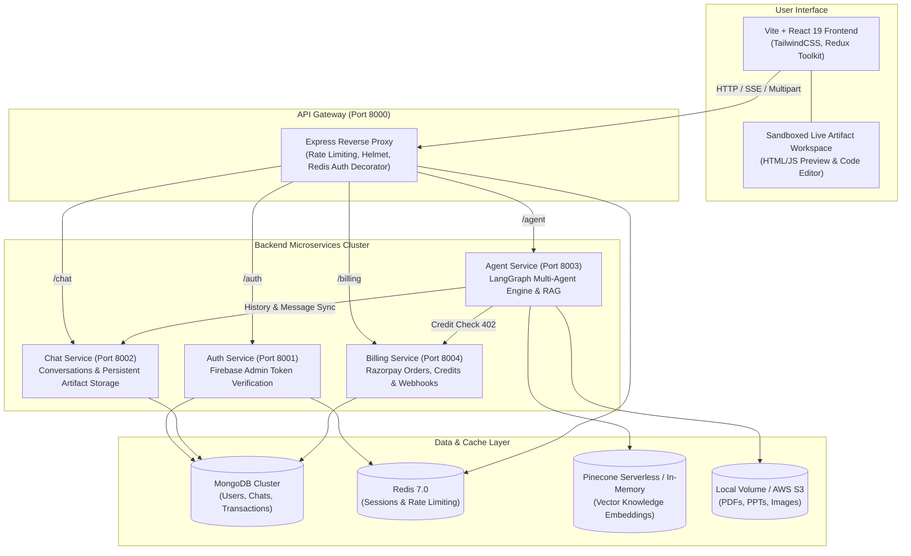

# Cortex AI: Production Multi-Agent AI Platform

[](https://github.com/rohitkumar2438/Cortex.ai/actions/workflows/ci.yml)
[](LICENSE)
[](docker-compose.yml)
[](https://nodejs.org/)
[](https://react.dev/)

Cortex AI is an enterprise-grade, microservice-powered **Multi-Agent AI Platform** built with **LangGraph StateGraph**, **Groq**, **DeepSeek**, **Tavily**, **Razorpay**, and a **Pinecone Serverless RAG Pipeline**.

---

## 1. System Architecture



---

## 2. Specialized Agents

| Agent | Engine / Model | Capabilities | Credit Cost |
| :--- | :--- | :--- | :---: |
| **Chat** | Groq LLaMA 3.3 70B | History-aware, thoughtful reasoning, structured GitHub Markdown. | 1 credit |
| **Search** | Tavily Live Web API | Real-time web browsing, factual citations, and relevant image discovery. | 2 credits |
| **Coding** | DeepSeek V3 / Coder | Full-stack project generation `{ files, language, preview }` rendered in a live sandboxed iframe editor. | 3 credits |
| **PDF** | PDFKit + Groq | Formal report drafting, styled banners, table of contents, and compiled downloadable `.pdf`. | 5 credits |
| **PowerPoint** | PptxGenJS + Groq | Structured slide decks with executive headers, bullet points, and downloadable `.pptx`. | 5 credits |
| **Image** | Pollinations / Flux | High-resolution text-to-image prompt enhancement and instant generation. | 5 credits |

---

## 3. Core Capabilities

### ⚡ LangGraph Multi-Agent Orchestration & SSE Streaming
- Dynamic router node classifying user intents across 6 agents.
- Real-time Server-Sent Events (`/agent/stream`) streaming transitions: `Thinking` ➔ `Reasoning` ➔ `Generating`.

### 📄 Retrieval-Augmented Generation (RAG)
- **Vector DB:** Pinecone Serverless (with transparent In-Memory Cosine Similarity fallback for local dev).
- **Document Ingestion:** Upload PDF, TXT, or Markdown documents via `POST /agent/rag/upload`.
- **Context Injection:** Automatic semantic retrieval filtered by `userId` and `conversationId`.
- **Citations:** Explicit document source citations (`> 📄 Cited Knowledge Documents: *filename.pdf*`).

### 💳 Razorpay Credit Packs & Billing Engine
- **Credit Packs:** 100 Credits (₹99), 500 Credits (₹399), 1,000 Credits (₹699).
- **Atomic Operations:** Balance increment and deductions powered by MongoDB `$inc`.
- **Idempotency:** Webhook and payment verification guards against double-crediting.
- **Pre-flight Enforcement:** Agent calls return HTTP 402 with required/current credit breakdown when balance is low.

### 💻 Live Artifact Workspace
- Interactive code editor with syntax highlighting, multi-file tabs, and sandboxed live preview.
- Message persistence ensures artifacts are restored immediately upon reload or session switching.

---

## 4. Quickstart Guide

### Option A: Docker Compose (Single Command)

1. Clone the repository:
   ```bash
   git clone https://github.com/rohitkumar2438/Cortex.ai.git
   cd Cortex.ai
   ```

2. Create your environment configuration:
   ```bash
   cp .env.example .env
   # Add your API keys (GROQ_API_KEY, TAVILY_API_KEY, etc.) in .env
   ```

3. Launch all containers:
   ```bash
   docker compose up --build
   ```

4. Open `http://localhost:5173` in your browser.

---

### Option B: Local Development (Manual Setup)

#### 1. Start Databases
Ensure **MongoDB** (port 27017) and **Redis** (port 6379) are running locally.

#### 2. Start Microservices in Separate Terminals

```powershell
# Terminal 1 - API Gateway (Port 8000)
cd backend/gateway
npm install
npm run dev

# Terminal 2 - Auth Service (Port 8001)
cd backend/services/auth
npm install
npm run dev

# Terminal 3 - Chat Service (Port 8002)
cd backend/services/chat
npm install
npm run dev

# Terminal 4 - Agent Service (Port 8003)
cd backend/services/agent
npm install
npm run dev

# Terminal 5 - Billing Service (Port 8004)
cd backend/services/billing
npm install
npm run dev

# Terminal 6 - Frontend (Port 5173)
cd frontend
npm install --legacy-peer-deps
npm run dev
```

---

## 5. Environment Variables Reference

| Variable | Service | Description |
| :--- | :--- | :--- |
| `PORT` | All Services | Service listener port (8000, 8001, 8002, 8003, 8004) |
| `MONGO_URI` | Auth, Chat, Billing | MongoDB connection string (e.g. `mongodb://localhost:27017/cortex`) |
| `REDIS_URL` | Gateway, Auth, Chat | Redis URL for session storage & rate limiting (`redis://localhost:6379`) |
| `GROQ_API_KEY` | Agent | Groq Cloud API Key for LLaMA 3.3 70B inference |
| `TAVILY_API_KEY` | Agent | Tavily API Key for real-time web search |
| `DEEPSEEK_API_KEY` | Agent | DeepSeek API Key for full-stack coding agent |
| `PINECONE_API_KEY` | Agent | Pinecone API key for RAG vector index (optional) |
| `PINECONE_INDEX` | Agent | Pinecone index name (default: `cortex-ai`) |
| `RAZORPAY_KEY_ID` | Billing | Razorpay API Key ID (dev mock mode enabled if blank) |
| `RAZORPAY_KEY_SECRET` | Billing | Razorpay Key Secret for HMAC verification |
| `RAZORPAY_WEBHOOK_SECRET` | Billing | Secret for webhook signature verification |
| `FIREBASE_SERVICE_ACCOUNT_KEY` | Auth | Firebase Admin JSON for token verification |
| `VITE_API_URL` | Frontend | Target API Gateway URL (`http://localhost:8000`) |

---

## 6. API Reference (Gateway Port 8000)

Frontend communicates exclusively with the **API Gateway** on port `8000`.

### Authentication (`/auth`)
- `POST /auth/login`: Authenticate with Firebase `idToken` and establish cookie session.
- `POST /auth/logout`: Destroy Redis session and clear cookies.
- `GET /auth/me`: Fetch authenticated user profile and credit balance.

### Chat & Sessions (`/chat`)
- `GET /chat/conversations`: List user conversations ordered by last active.
- `POST /chat/conversations`: Create a new conversation session.
- `GET /chat/conversations/:id/messages`: Retrieve message history (includes artifacts, URLs, and images).
- `POST /chat/conversations/:id/messages`: Persist a user or assistant message.
- `DELETE /chat/conversations/:id`: Delete a conversation session.

### Agent Orchestration & RAG (`/agent`)
- `POST /agent/run`: Synchronous agent workflow execution.
- `POST /agent/stream`: Server-Sent Events stream (`Thinking` ➔ `Reasoning` ➔ `Generating` ➔ `Result`).
- `GET /agent/downloads/:filename`: Download locally generated PDF, PPT, or Image files.
- `POST /agent/rag/upload`: Upload PDF or TXT document for RAG chunking & vector indexing.
- `GET /agent/rag/documents`: List active knowledge documents for the conversation.
- `DELETE /agent/rag/documents/:docName`: Remove a document from the RAG knowledge base.

### Billing & Payments (`/billing`)
- `GET /billing/packs`: Retrieve available credit packs (100, 500, 1000).
- `POST /billing/order`: Create Razorpay payment order.
- `POST /billing/verify`: Verify Razorpay signature and atomically add credits.
- `POST /billing/deduct`: Deduct credits per-agent execution (returns 402 if balance insufficient).
- `GET /billing/transactions`: View past credit purchase transactions.
- `POST /billing/webhook`: Idempotent Razorpay webhook listener.

---

## 7. Cloud Deployment (AWS)

See [`docs/aws-deployment-guide.md`](docs/aws-deployment-guide.md) for step-by-step instructions on deploying Cortex AI to AWS:
- **Compute:** Amazon ECS Fargate or Amazon EC2 behind an Application Load Balancer.
- **Storage:** Amazon S3 for generated files with presigned URLs and CloudFront CDN for the frontend.
- **Database:** MongoDB Atlas with VPC peering and Amazon ElastiCache (Redis).
- **Secrets:** Storing credentials securely in AWS Systems Manager (SSM) Parameter Store.
