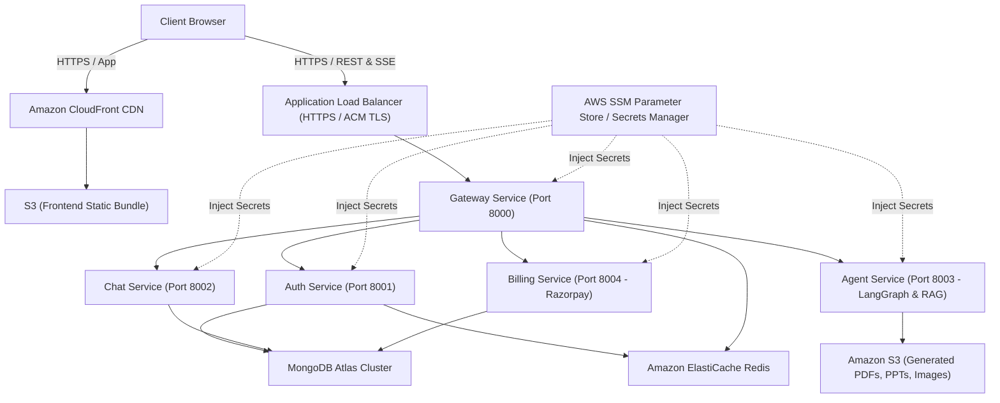

# Cortex AI: Production AWS Cloud Architecture & Deployment Guide

This guide details the complete production deployment procedure for Cortex AI across **Amazon ECS Fargate / EC2**, **Amazon ECR**, **Application Load Balancer (ALB)**, **Amazon S3**, **Amazon CloudFront**, **AWS Systems Manager (SSM) / Secrets Manager**, and **MongoDB Atlas**.

---

## 1. Cloud Architecture Overview



---

## 2. Infrastructure Setup Options

You can deploy Cortex AI using either **Amazon ECS Fargate (Serverless Containers)** or a dedicated **Amazon EC2 Instance** behind an ALB.

### Option A: Amazon ECS Fargate (Recommended for High Availability)
1. **Amazon ECR Repositories:**
   Create 5 private repositories: `cortex-gateway`, `cortex-auth`, `cortex-chat`, `cortex-agent`, `cortex-billing`.
2. **ECS Cluster & Fargate Services:**
   - Create cluster: `cortex-ai-cluster`.
   - Register task definitions using images pulled from ECR with CloudWatch logging enabled.
   - Configure **AWS Cloud Map / Service Connect** for internal DNS:
     - `auth.cortex.local:8001`
     - `chat.cortex.local:8002`
     - `agent.cortex.local:8003`
     - `billing.cortex.local:8004`
3. **Application Load Balancer (ALB):**
   - Internet-facing ALB with AWS Certificate Manager (ACM) SSL certificate.
   - Forward HTTPS port 443 to the `cortex-gateway` target group (port 8000).

### Option B: Amazon EC2 with Docker Compose (Cost-Effective & Simple)
1. Launch an `Ubuntu 22.04 LTS` instance (recommended: `t3.large` or `t3.xlarge`).
2. Attach an IAM role with `AmazonSSMReadOnlyAccess` and `AmazonS3FullAccess`.
3. Install Docker & Docker Compose:
   ```bash
   sudo apt update && sudo apt install -y docker.io docker-compose git
   sudo usermod -aG docker ubuntu
   ```
4. Clone the repository and run:
   ```bash
   git clone https://github.com/rohitkumar2438/Cortex.ai.git
   cd Cortex.ai
   cp .env.example .env
   # Populate production credentials in .env
   docker-compose -f docker-compose.yml up -d --build
   ```
5. Place the EC2 instance in a private subnet behind an ALB forwarding HTTPS (port 443) to port 8000.

---

## 3. Storage & Database Setup

### Amazon S3 for Generated Files & Artifacts
1. Create an S3 bucket: `cortex-ai-generated-artifacts` (in the same AWS region as your compute).
2. Block public access: Enabled.
3. Configure **CORS Configuration**:
   ```json
   [
     {
       "AllowedHeaders": ["*"],
       "AllowedMethods": ["GET", "PUT", "POST", "HEAD"],
       "AllowedOrigins": ["https://yourdomain.com", "http://localhost:5173"],
       "ExposeHeaders": ["ETag"]
     }
   ]
   ```
4. Cortex AI uses presigned URLs with TTL for secure, temporary user downloads without exposing bucket credentials.

### MongoDB Atlas Setup
1. Create an **M10+ Dedicated Cluster** (or M0 Free Tier for testing) on AWS region `us-east-1`.
2. **Network Access / Security:**
   - Whitelist your VPC NAT Gateway Elastic IPs, or configure **VPC Peering / AWS PrivateLink**.
3. **Database Users:**
   - Create user `cortex_prod_user` with `readWriteAnyDatabase` role.
4. Copy the connection string into `MONGO_URI`:
   `mongodb+srv://cortex_prod_user:<password>@cluster0.xxxx.mongodb.net/cortex?retryWrites=true&w=majority`

### Amazon ElastiCache (Redis)
1. Provision a Redis 7.x replication group in your private subnets.
2. Ensure the security group permits inbound TCP traffic on port `6379` exclusively from the Gateway and microservices.
3. Set `REDIS_URL=redis://your-cluster-node.cache.amazonaws.com:6379`.

---

## 4. Secrets Management with AWS Systems Manager (SSM) & Secrets Manager

Never hardcode production API credentials in Git or Docker images. Store them securely in **AWS SSM Parameter Store** (SecureString) or **AWS Secrets Manager**:

### SSM Parameter Store Hierarchy
```
/cortex/prod/MONGO_URI
/cortex/prod/REDIS_URL
/cortex/prod/GROQ_API_KEY
/cortex/prod/DEEPSEEK_API_KEY
/cortex/prod/TAVILY_API_KEY
/cortex/prod/PINECONE_API_KEY
/cortex/prod/RAZORPAY_KEY_ID
/cortex/prod/RAZORPAY_KEY_SECRET
/cortex/prod/RAZORPAY_WEBHOOK_SECRET
/cortex/prod/FIREBASE_SERVICE_ACCOUNT_KEY
```

### ECS Task Definition Environment Secrets Injection
In your ECS Task Definition, reference secrets directly via ARN:
```json
{
  "name": "GROQ_API_KEY",
  "valueFrom": "arn:aws:ssm:us-east-1:123456789012:parameter/cortex/prod/GROQ_API_KEY"
}
```

---

## 5. Frontend S3 & CloudFront CDN Deployment

1. **S3 Static Website Bucket:**
   - Bucket: `cortex-ai-frontend`
2. **CloudFront Distribution:**
   - Origin: `cortex-ai-frontend.s3.amazonaws.com` with Origin Access Control (OAC).
   - Viewer Protocol Policy: **Redirect HTTP to HTTPS**.
   - Custom Error Response:
     - HTTP Error Code: `403` & `404`
     - Response Page Path: `/index.html`
     - HTTP Response Code: `200` (Required for React Single Page Application routing).
3. **Firebase Authentication Authorized Domains:**
   - Add CloudFront distribution domain (`d111111abcdef.cloudfront.net`) and your custom domain in the Firebase Console under **Authentication > Settings > Authorized domains**.

---

## 6. GitHub Actions Secrets Configuration

Configure the following secrets in your GitHub repository (**Settings > Secrets and variables > Actions**):

| Secret Name | Description |
| :--- | :--- |
| `AWS_ACCESS_KEY_ID` | IAM deployment user access key |
| `AWS_SECRET_ACCESS_KEY` | IAM deployment user secret key |
| `AWS_REGION` | AWS Region (e.g. `us-east-1`) |
| `FRONTEND_S3_BUCKET` | S3 bucket name for frontend static bundle |
| `CLOUDFRONT_DISTRIBUTION_ID` | CloudFront Distribution ID for automatic cache invalidation |
| `VITE_PRODUCTION_GATEWAY_URL` | Public ALB URL (e.g. `https://api.yourdomain.com`) |
| `VITE_FIREBASE_API_KEY` | Firebase Client Web SDK API Key |
| `VITE_FIREBASE_AUTH_DOMAIN` | Firebase Client Web SDK Auth Domain |
| `VITE_FIREBASE_PROJECT_ID` | Firebase Project ID |
| `VITE_FIREBASE_STORAGE_BUCKET` | Firebase Storage Bucket |
| `VITE_FIREBASE_MESSAGING_SENDER_ID` | Firebase Messaging Sender ID |
| `VITE_FIREBASE_APP_ID` | Firebase Web App ID |
| `RAZORPAY_KEY_ID` | Razorpay Live Key ID |
